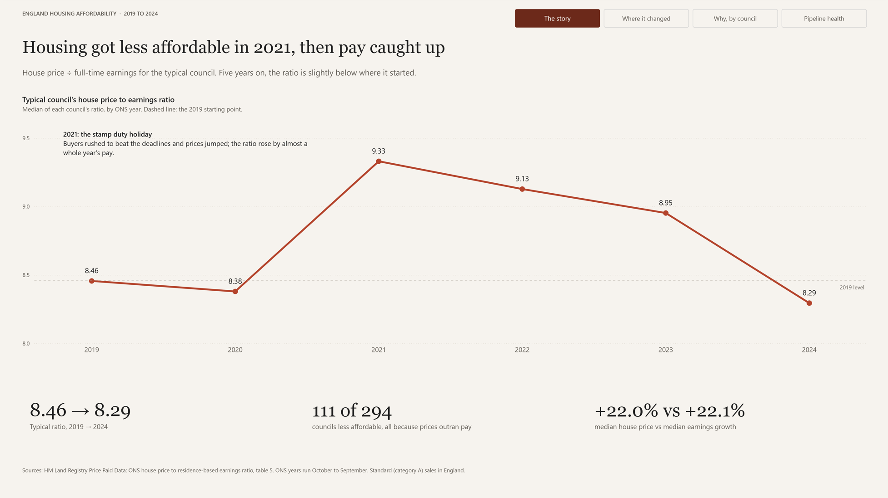
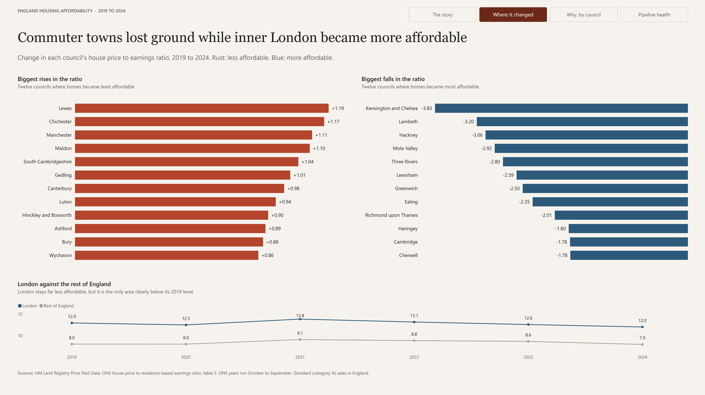
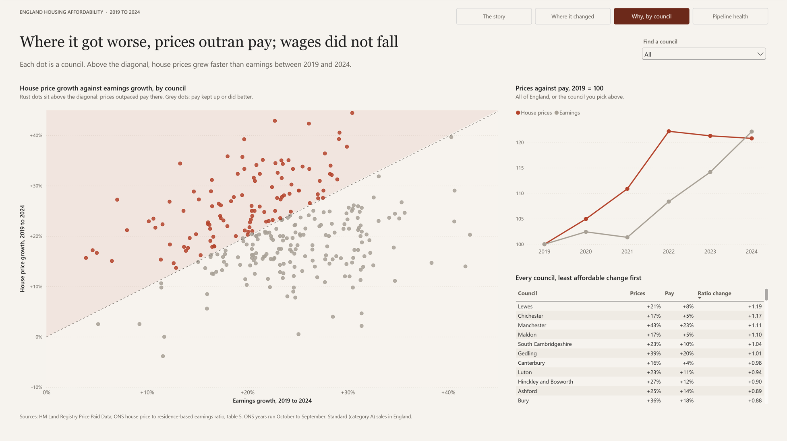
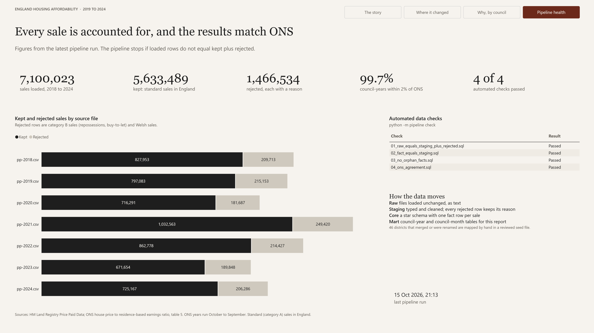
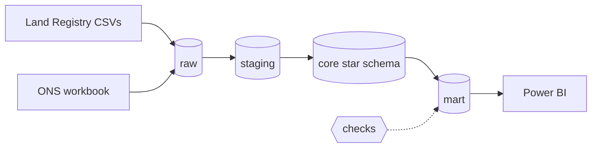

# England housing affordability pipeline

An end-to-end data pipeline that loads every residential sale in England from HM Land Registry (7.1 million rows, 2018 to 2024) alongside ONS earnings data, cleans and models it in PostgreSQL, checks that every row is accounted for, and feeds a Power BI report on how affordable housing is in each council.


## The question and the answer

**How affordable is housing across England's councils, and how has that changed since 2019?**

Between 2019 and 2024, housing became less affordable in **111 of 294 councils**. In every one of them, prices rose faster than pay; pay did not fall anywhere. For the typical council, the ratio of house price to earnings jumped to **9.33 in 2021** (the stamp duty holiday), then eased to **8.29 by 2024**, slightly below where it started (8.46). London improved most: its typical ratio fell from 12.9 to 12.0, about 9% more affordable, against about 1% elsewhere.



| Where it changed | Why, by council | Pipeline health |
|---|---|---|
|  |  |  |

## Architecture



| Layer | Schema | What it holds |
|---|---|---|
| Raw | `raw` | Files loaded unchanged, every column as text, tagged with the source file and load time |
| Staging | `staging` | Typed and cleaned sales in `staging.sales`; every rejected row in `staging.sales_rejected` with its reason |
| Core | `core` | Star schema: `fact_sale` and `fact_earnings` with `dim_date`, `dim_council` and `dim_property` |
| Mart | `mart` | `council_year` and `council_month`, the tables the report reads |
| Bookkeeping | `etl` | `run_log`: rows in, out and rejected for every step of every run |

Design decisions:

- **Raw is never edited.** A bad value can't stop a load, and any later layer can be rebuilt from raw without downloading again.
- **Reject, don't delete.** Category B sales (repossessions, buy-to-let) and Welsh sales are rejected with a reason, so raw always equals kept plus rejected. The pipeline stops if that doesn't hold.
- **Flag, don't remove.** Sales under £10k or over £10m are kept but flagged as outliers.
- **Council matching is explicit.** Land Registry still uses district names that have since merged or been renamed. 315 districts match ONS automatically; the other 46 are mapped by hand in [`seeds/district_to_council.csv`](seeds/district_to_council.csv), each with a note saying why.
- **ONS years run October to September.** Every sale is given an ONS year, so the figures line up with the official series.

## Data sources and licence

- [HM Land Registry Price Paid Data](https://www.gov.uk/government/statistical-data-sets/price-paid-data-downloads), yearly files 2018 to 2024
- [ONS: House price to residence-based earnings ratio](https://www.ons.gov.uk/peoplepopulationandcommunity/housing/datasets/ratioofhousepricetoresidencebasedearningslowerquartileandmedian), table 5 (local authority medians)

Contains HM Land Registry data © Crown copyright and database right 2026. This data is licensed under the Open Government Licence v3.0.

Source: Office for National Statistics licensed under the Open Government Licence v3.0.

## How to run it

**Prerequisites:** Python 3.12, PostgreSQL 17, and Power BI Desktop to open the report.

1. Clone the repo and create a virtual environment:

   ```bash
   git clone https://github.com/dhk-developer/housing-affordability-pipeline.git
   cd housing-affordability-pipeline
   py -3.12 -m venv .venv
   .venv\Scripts\activate
   pip install -r requirements.txt
   ```

   On macOS or Linux, use `python3.12 -m venv .venv` and `source .venv/bin/activate`.

2. Create a database and a user for the pipeline (in `psql`, as the `postgres` superuser):

   ```sql
   CREATE USER etl_user WITH PASSWORD 'choose-a-password';
   CREATE DATABASE housing OWNER etl_user;
   ```

3. Copy `.env.example` to `.env` and put your password in it. `.env` is ignored by Git, so the password stays on your machine.

4. Run the pipeline, then the checks:

   ```bash
   python -m pipeline run --years 2018-2024
   python -m pipeline check
   ```

   `run` downloads the files (skipping any already downloaded), loads raw, builds staging, core and the marts, and prints a reconciliation line for every file. `check` re-runs the four SQL checks in [`sql/checks`](sql/checks) without rebuilding anything.

5. Open `powerbi/housing_affordability.pbip` in Power BI Desktop and click **Refresh**.

To run the unit tests (no database needed): `pytest -v`. They also run on GitHub Actions for every push and pull request.

## Data quality

| Measure | Value |
|---|---|
| Sales loaded from Land Registry | 7,100,023 |
| Kept | 5,633,489 |
| Rejected: category B | 1,158,957 |
| Rejected: Wales (out of scope) | 307,577 |
| Rejected: bad price or date | 0 |
| Kept but flagged as outliers | 861 |
| Districts mapped by hand (seed file) | 46 |
| Council-years within 2% of the ONS median price | 99.7% (1,770 of 1,776) |

The pipeline's medians reproduce the official ONS figures to within 2% for 1,770 of 1,776 council-years. The six that differ (by 2.4% to 3.6%) are all in high-price or new-build-heavy areas, most likely because this download includes sales registered after ONS published.

## Findings

- **111 of 294 councils became less affordable** between 2019 and 2024. In all 111, prices and pay both rose; prices simply rose faster. In the other 183, pay outpaced prices.
- **The 2021 spike was policy-driven.** Sales fell from about 66,000 a month in 2019 to 24,000 in April 2020 (lockdown), then peaked at about 160,000 in June 2021 and 126,000 in March 2021, the two stamp duty holiday deadlines.
- **London became more affordable.** 29 of 32 boroughs improved, and the typical London ratio fell from 12.9 to 12.0 (Mann-Whitney U test against the rest of England: p < 0.000001). London is still far less affordable than anywhere else.
- **Commuter towns and the coast lost ground.** Lewes, Chichester, Manchester and Maldon saw the biggest rises in the ratio.
- **New building shows no meaningful link** with the change in affordability (Spearman ρ = 0.10, p = 0.09).

## Limitations

- Sale prices only, not rents or mortgage costs, so the rise in interest rates since 2022 is not captured.
- Residence-based earnings for full-time workers only.
- Medians move with the mix of homes sold (the composition effect): in 2020, detached houses rose to 28% of sales and flats fell to 17%.
- Two low-volume councils (City of London, Isles of Scilly) are excluded from rankings.
- ONS year 2018 isn't complete in this data, so comparisons start at 2019; the 2018 file still feeds the October to December 2018 part of ONS year 2019.

## Repository layout

```text
pipeline/        Python package: extract, load_raw, councils, transform, checks, analysis, CLI (__main__.py)
sql/             Numbered SQL files, run in order: schemas, raw, staging, core, marts
sql/checks/      Reconciliation checks run by `python -m pipeline check`
seeds/           Hand-checked district-to-council mapping
tests/           pytest unit tests (run in CI)
notebooks/       01_profiling (is the data believable?) and 02_analysis (the answer)
powerbi/         Power BI project (.pbip), saved as text so changes show up in Git
docs/            Project diary and report screenshots
scripts/         time_load.py: times COPY against pandas to_sql on the same 100,000 rows
```

## Next steps

- **Incremental loads:** Land Registry publishes a monthly change file. Loading only that, instead of whole years, would make each run much faster.
- **Scheduling:** run the pipeline monthly (Windows Task Scheduler, cron, or an orchestrator such as Airflow) and alert if a check fails.
- **Microsoft Fabric:** the layers map directly onto a Lakehouse medallion design: raw is bronze, staging is silver, and the marts are gold.
- **Rents and mortgage costs:** adding ONS private rents and Bank of England mortgage rates would capture what sale prices miss.
